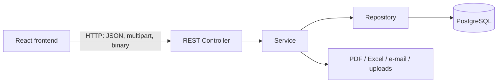
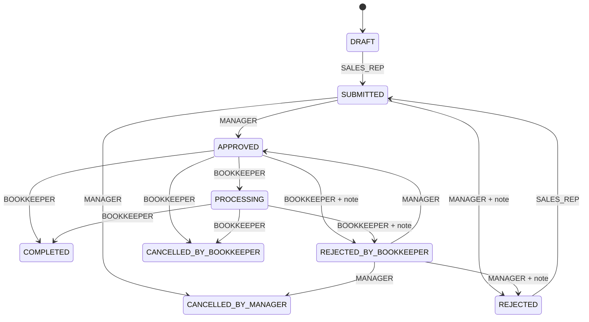
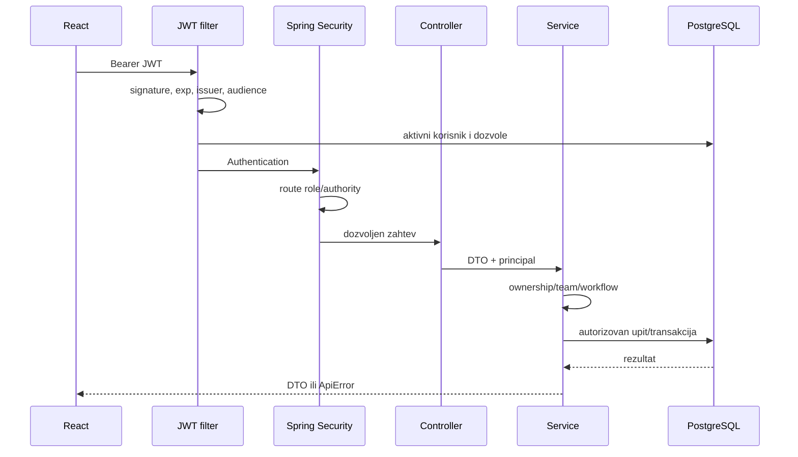

# REST API ugovor aplikacije „Sena Spirits — Respekt“

> Provereno: 19. novembar 2026.
>
> Izvor istine: aktuelni Spring Boot i React/TypeScript kod.
>
> Obuhvat: 11 REST kontrolera i 57 aktivnih endpoint-a.

## 1. Uvod

Dokument opisuje javni REST ugovor Spring Boot backend-a: rute, autentikaciju, autorizaciju, DTO strukture, validaciju, poslovna pravila i komunikaciju sa React frontend-om. Baza je PostgreSQL. Kontroleri primaju HTTP zahteve, servisi sprovode poslovna pravila i transakcije, a repozitorijumi izvršavaju upite.

Podrazumevana lokalna osnova je `http://localhost:8080/api`. JSON je standardni format, osim multipart slanja slike i binarnih PDF/XLSX odgovora. Datumi se serijalizuju u ISO-8601 formatu.



Osnovna načela su: DTO granica, serverska autorizacija, transakcijska poslovna pravila, SQL paginacija za velike liste i centralizovan format greške.

## 2. Autentikacija i JWT

Javni endpoint-i su `POST /api/auth/login` i `GET /api/health`. Statički resursi `/products/**` takođe su javni, ali nisu REST endpoint-i. Ostali endpoint-i zahtevaju JWT.

### 2.1 Prijava

```http
POST /api/auth/login
Content-Type: application/json
```

```json
{"email":"korisnik@example.test","password":"bezbedna-lozinka"}
```

Uspeh je `200 OK` i `AuthResponse`:

```json
{
  "accessToken": "<JWT>",
  "tokenType": "Bearer",
  "expiresIn": 3600,
  "user": {
    "id": 12,
    "email": "korisnik@example.test",
    "firstName": "Petar",
    "lastName": "Petrović",
    "role": "SALES_REP",
    "permissions": ["customers.read", "requisitions.read"]
  }
}
```

Klijent šalje `Authorization: Bearer <accessToken>`. `JwtAuthenticationFilter` kriptografski proverava token jednom, zatim iz baze učitava aktuelnog korisnika, ulogu i dozvole. Neaktivan ili obrisan korisnik ne može koristiti ranije izdat token. Proveravaju se potpis, istek, `issuer`, `audience` i subject. Token bez važećih issuer/audience claim-ova se odbija.

Prijava ima konfigurabilno ograničenje učestalosti. Podrazumevani prozor je 15 minuta, sa najviše 50 pokušaja po IP adresi i 10 po normalizovanom identitetu, uz najviše 10.000 zapisa u memoriji. Prekoračenje vraća `429`. Adresa koju vidi servlet je izvor IP-a; aplikacija ne veruje proizvoljnom `X-Forwarded-For` zaglavlju.

`401 Unauthorized` znači da identitet nije potvrđen. `403 Forbidden` znači da je korisnik potvrđen, ali nema potrebnu ulogu/dozvolu ili pristup konkretnom resursu.

## 3. Uloge, dozvole i domet

Podržane poslovne uloge su `CEO`, `MANAGER`, `SALES_REP` i `BOOKKEEPER`. Spring Security proverava rutu, a servis zatim vlasništvo, tim, status i workflow.

| Funkcionalnost | CEO | MANAGER | SALES_REP | BOOKKEEPER |
|---|---:|---:|---:|---:|
| Kupci | cela kompanija | svoj tim | sopstveni | ne |
| Kreiranje/izmena kupca | ne | status i dodela u timu | kreira/menja sopstvene | ne |
| Zaposleni | upravljanje | pregled svog tima | ne | ne |
| Proizvodi | upravljanje | aktivni katalog | aktivni katalog | administrativni pregled |
| Trebovanja | kompanijski pregled | svoj tim | sopstvena + kreiranje | računovodstvena stanja |
| Izveštaji | kompanija/tim/pojedinac | tim/pojedinac | samo sopstveni | ne |
| AI rizik | kompanija | svoj tim | sopstveni kupci | ne |
| Robna trebovanja | sva | tim | kreira/sopstvena | obrada/sva |
| Reklamni materijal | upravljanje/sve | tim | raspodela/sopstvene | ne |

Efektivni pristup je presek URL pravila, dozvola iz baze i servisnih pravila. Frontend skrivanje dugmeta nije zamena za backend autorizaciju.

## 4. Kompletan katalog endpoint-a

### 4.1 Autentikacija i health

| Metod i putanja | Pristup | Uspeh | Svrha |
|---|---|---:|---|
| `POST /api/auth/login` | javno | 200 | Prijava i JWT |
| `GET /api/auth/me` | prijavljen korisnik | 200 | Aktuelni `UserResponse` |
| `GET /api/health` | javno | 200 text/plain | Vraća `100% health` |

Prazna polja prijave daju 400, pogrešni kredencijali 401, a prekoračenje učestalosti 429.

### 4.2 Zaposleni

| Metod i putanja | Ulaz | Pristup | Odgovor |
|---|---|---|---|
| `GET /api/employees` | — | `employees.read`, servisno CEO | `List<EmployeeResponse>` |
| `GET /api/employees/manager-options` | — | CEO | `List<EmployeeManagerResponse>` |
| `POST /api/employees` | `EmployeeCreateRequest` | CEO | 201 `EmployeeResponse` |
| `PATCH /api/employees/{employeeId}` | `EmployeeUpdateRequest` | CEO | `EmployeeResponse` |
| `PATCH /api/employees/{employeeId}/active` | `{"active":boolean}` | CEO | `EmployeeResponse` |
| `GET /api/employees/team-summary` | `managerId?` | MANAGER ili CEO | `List<TeamMemberSummaryResponse>` |
| `GET /api/employees/managers` | — | CEO | `List<ManagerTeamSummaryResponse>` |

Kreiraju se samo `SALES_REP`, `MANAGER` i `BOOKKEEPER`. SALES_REP mora imati aktivnog menadžera; drugi ne smeju imati `managerId`. E-mail je jedinstven. Lozinka ima najmanje 8 znakova i najviše 72 UTF-8 bajta. PATCH nije merge-patch: ime, prezime i e-mail su obavezni; `role` i `password` ne smeju se menjati. Menadžer sa komercijalistima i komercijalista sa kupcima ne mogu se deaktivirati (409). MANAGER za team-summary ne sme slati `managerId`; CEO ga mora poslati.

### 4.3 Kupci

| Metod i putanja | Ulaz | Pristup | Odgovor |
|---|---|---|---|
| `GET /api/customers` | `search?`, `page=0`, `size=24` | `customers.read` | `CustomerPageResponse` |
| `GET /api/customers/{customerId}` | ID | permission + domet | `CustomerResponse` |
| `GET /api/customers/team-sales-representatives` | — | MANAGER | lista opcija |
| `POST /api/customers` | `CustomerRequest` | SALES_REP | 201 `CustomerResponse` |
| `PUT /api/customers/{customerId}` | `CustomerRequest` | vlasnički SALES_REP | `CustomerResponse` |
| `PATCH /api/customers/{customerId}/status` | `{"status":CustomerStatus}` | MANAGER, svoj tim | `CustomerResponse` |
| `PATCH /api/customers/{customerId}/sales-representative` | pozitivan `salesRepresentativeId` | MANAGER, svoj tim | `CustomerResponse` |

`page` se normalizuje na najmanje 0, `size` na 1–100. SQL primenjuje pretragu, status i domet pre paginacije; sortiranje je `updatedAt DESC`. Statusi su `DRAFT`, `APPROVED`, `DEACTIVATED`. CEO vidi sva tri, MANAGER svoj tim, SALES_REP sopstvene DRAFT/APPROVED. Nedostupan ili tuđ resurs vraća 404 bez otkrivanja postojanja.

### 4.4 Proizvodi

| Metod i putanja | Ulaz | Pristup | Odgovor |
|---|---|---|---|
| `GET /api/products` | `search?`, `status=ALL`, `page=0` | CEO, BOOKKEEPER | `ProductPageResponse` |
| `GET /api/products/available` | — | SALES_REP, MANAGER | `List<ProductResponse>` |
| `POST /api/products` | multipart `product` + opcioni `image` | CEO | 201 management DTO |
| `PATCH /api/products/{productId}/deactivate` | bez tela | CEO | management DTO |

Management stranica ima fiksno 15 zapisa, filter `ALL|ACTIVE|INACTIVE` i `name ASC,id ASC`. Available vraća aktivne proizvode. Šifra se normalizuje na velika slova i jedinstvena je. `packageType` je `BOTTLE` za zapreminu ≤ 1 l, inače `JUG`. Slika je do 5 MiB i stvarni sadržaj mora biti JPEG, PNG ili WebP. Bez slike se čuva `products/placeholder.jpg`. Deaktivacija je jednosmerna; ponavljanje daje 409.

```text
multipart/form-data
part product; Content-Type: application/json
{"name":"Proizvod X","code":"PX-1","price":1200.00,"volumeLiters":0.75,
 "stimulationPerUnit":20.00,"managerStimulationPerUnit":5.00}
part image; Content-Type: image/webp; filename="proizvod.webp" (opciono)
```

### 4.5 Trebovanja

| Metod i putanja | Ulaz | Pristup | Odgovor |
|---|---|---|---|
| `POST /api/requisitions` | `RequisitionRequest` | SALES_REP | 201 detalj |
| `GET /api/requisitions/{id}` | ID | `requisitions.read` + domet | detalj |
| `PUT /api/requisitions/{id}` | `RequisitionRequest` | SALES_REP/MANAGER + workflow | detalj |
| `PATCH /api/requisitions/{id}/status` | status request | SALES_REP/MANAGER/BOOKKEEPER | detalj |
| `GET /api/requisitions/page` | `year,month,page=0,search?,status?` | permission + domet | `RequisitionPageResponse` |
| `GET /api/requisitions/customer/{customerId}/page` | `year,month,page=0` | permission + kupac | summary page |
| `GET /api/requisitions/dashboard-statistics` | `year,month` | `requisitions.read` | mesečni brojači |
| `GET /api/requisitions/{id}/pdf` | ID | permission + domet | PDF |
| `POST /api/requisitions/{id}/email` | `RequisitionEmailRequest` | BOOKKEEPER | 204 |

`year` je 2000–2100, `month` 1–12. Liste imaju fiksno 20 zapisa, SQL paginaciju i `createdAt DESC,id DESC`. Period, domet, status i pretraga primenjuju se pre upita za stranicu i ukupan broj. Glavni odgovor ima `totalCount,totalElements,gratisCount,normalCount,totalPages,pageNumber,content`; istorija kupca ima `totalElements,totalPages,pageNumber,content`. Stare rute `GET /api/requisitions` i `GET /api/requisitions/customer/{id}` nisu aktivne.

PDF i e-mail zahtevaju `COMPLETED`. PDF je attachment. E-mail body bira `recipient: SALES_REP|CUSTOMER`; koristi sačuvanu adresu i ne prima proizvoljnu. Pogrešan status ili nedostajuća adresa daju 409.

### 4.6 Robna trebovanja

| Metod i putanja | Ulaz | Pristup | Odgovor |
|---|---|---|---|
| `POST /api/goods-requests` | `GoodsRequestRequest` | SALES_REP | 201 row DTO |
| `GET /api/goods-requests` | `year,month` | `goods-requests.read` | mesečna lista |
| `PATCH /api/goods-requests/{id}/status` | `APPROVED|REJECTED` | BOOKKEEPER | row DTO |

Zahtev ima neprazne stavke i napomenu do 5000 znakova. Stavka ima pozitivnu količinu i tačno jednu referencu: `productCode` ili `materialId`. Duplikati i nedostupne reference se odbijaju. Stavke imaju `PENDING|APPROVED|REJECTED`; obrada menja pending stavke. Lista nije paginirana. CEO i BOOKKEEPER vide kompaniju, MANAGER tim, SALES_REP sopstvene.

### 4.7 Reklamni materijal i raspodele

| Metod i putanja | Ulaz | Pristup | Odgovor |
|---|---|---|---|
| `GET /api/advertising-materials` | — | CEO | management lista |
| `GET /api/advertising-materials/available` | — | `advertising-materials.read` | aktivna lista |
| `POST /api/advertising-materials` | `{"name":string}` | CEO | 201 management DTO |
| `PATCH /api/advertising-materials/{materialId}/active` | `{"active":boolean}` | CEO | management DTO |
| `POST /api/advertising-materials/distributions` | distribution request | SALES_REP | 201 lista raspodela |
| `GET /api/advertising-materials/distributions` | `year,month` | permission | mesečna lista |

Naziv je obavezan, case-insensitive jedinstven i do 150 znakova. Raspodela zahteva sopstvenog APPROVED kupca, neprazne jedinstvene aktivne materijale i pozitivne količine. Mesečna istorija nije paginirana: CEO sve, MANAGER tim, SALES_REP sopstvene.

### 4.8 Prodajni izveštaji

| Metod i putanja | Query | Domet | Odgovor |
|---|---|---|---|
| `GET /api/sales-reports/monthly` | `year,month,salesRepId?,managerId?` | autorizovan | monthly DTO |
| `GET /api/sales-reports/ytd` | `year,salesRepId?,managerId?` | autorizovan | YTD DTO |
| `GET /api/sales-reports/team-comparison` | `year,month,managerId?` | MANAGER tim; CEO izabrani tim | comparison |
| `GET /api/sales-reports/managers-comparison` | `year,month` | samo CEO | comparison |

Sve rute zahtevaju `sales-reports.read`; year je 2000–2100, month 1–12. CEO bez filtera dobija kompaniju i može izabrati menadžera/komercijalistu. MANAGER ne sme slati managerId i vidi svoj tim ili člana. SALES_REP može samo sebe i ne sme slati managerId.

Agregacija koristi `COMPLETED` trebovanja u periodu i vraća količine proizvoda, boce/balone, litre, vrednost i stimulacije. Stimulacije se računaju iz snapshot vrednosti stavke, ne iz kasnije promenjenog proizvoda. Mesečni period je `[početak meseca, početak sledećeg)`.

### 4.9 GRATIS izveštaji

| Metod i putanja | Query | Odgovor |
|---|---|---|
| `GET /api/sales-reports/gratis-monthly` | `year,month,salesRepId?,managerId?` | `MonthlyGratisReportResponse` |
| `GET /api/sales-reports/gratis-ytd` | `year,salesRepId?,managerId?` | `GratisYtdReportResponse` |

Važi isti autorizacioni opseg, ali se agregiraju završena GRATIS trebovanja. Rezultat sadrži zbir, proizvode i razloge `LISTING|CONSUMPTION|GIFT|OTHER`.

### 4.10 Excel izvozi

| Metod i putanja | Query | Odgovor |
|---|---|---|
| `GET /api/sales-reports/monthly/export` | kao monthly | XLSX attachment |
| `GET /api/sales-reports/ytd/export` | kao YTD | XLSX attachment |
| `GET /api/sales-reports/gratis-monthly/export` | kao gratis monthly | XLSX attachment |
| `GET /api/sales-reports/gratis-ytd/export` | kao gratis YTD | XLSX attachment |

Izvozi koriste isti autorizovani rezultat, odgovarajući XLSX content type, `Content-Disposition: attachment` i `Cache-Control: no-store`. Naslov označava kompaniju, tim ili komercijalistu.

### 4.11 Upozorenja

| Metod i putanja | Pristup | Odgovor |
|---|---|---|
| `GET /api/alerts` | svaki prijavljen | `AlertResponse` |

`{draftCustomers,requisitionAlerts,pendingGoodsRequests}`: MANAGER dobija draft kupce tima i zbir SUBMITTED + REJECTED_BY_BOOKKEEPER; SALES_REP svoja REJECTED; BOOKKEEPER APPROVED trebovanja i robne zahteve sa pending stavkama; ostali nule.

### 4.12 AI Decision Tree

| Metod i putanja | Ulaz | Odgovor |
|---|---|---|
| `GET /api/ai/customers/catalog` | obavezan `risk`, `search?`, `page=0,size=24` | `CustomerPageResponse` |
| `POST /api/ai/customers/risks/batch` | niz do 100 pozitivnih ID | `List<RiskBatchItem>` |
| `GET /api/ai/customers/risks` | `salesRepId?,managerId?,search?,risk?,page=0,size=20` | `RiskPage` |
| `GET /api/ai/summary` | `salesRepId?,managerId?` | `Summary` |
| `GET /api/ai/customers/{id}/risk` | ID | `Assessment` |
| `GET /api/ai/customers/{id}/activities` | ID | poslednjih 100 aktivnosti |
| `POST /api/ai/customers/{id}/activities` | `ActivityRequest` | 201 bez tela |

Sve AI rute zahtevaju ulogu SALES_REP/MANAGER/CEO i `customers.read`. BOOKKEEPER nema pristup. SALES_REP vidi svoje kupce, MANAGER tim, CEO kompaniju. Samo CEO bira managerId; SALES_REP ne bira drugog predstavnika.

Risk enum je `LOW|MEDIUM|HIGH|INSUFFICIENT_DATA`; size je 1–100. Catalog primenjuje status, domet i rizik u SQL-u pre LIMIT/OFFSET-a, a entity hydration čuva SQL redosled. Konkurentna nekonzistentnost daje konflikt umesto tihog smanjenja stranice.

Procena sadrži `level,at,status,features,factors,recommendation,stale`. Feature polja su `recencyDays,intervalDays,orders30,orders60,orders90,liters60,priorLiters60,relationshipDays`. Status opisuje procenjeno, nedovoljno podataka ili nedostupan model; `NOT_ASSESSED` je koncept odsustva reda, ne garantovana literalna DTO vrednost.

Aktivnost upisuje samo vlasnički SALES_REP. Type je `CONTACT|INVESTIGATE|MONITOR`; notes do 2000, obavezni outcome do 1000 znakova. Bez procene vraća se 409.

Nema aktivnih REST endpoint-a za ručni trening, osvežavanje procena, aktivaciju modela, informacije o modelu, nadzor ili trend rizika. Životni ciklus je interni i konfigurabilan: capture provera podrazumevano ima fiksno kašnjenje od 60 sekundi, dnevno održavanje procena radi u 02:15, a podobnost za trening proverava se nedeljom u 03:00, u zoni `Europe/Belgrade`. Pri pokretanju aplikacije obnavljaju se napušteni poslovi i istekli događaji, radi reconciliation/capture obrada i beleži propušteni nedeljni termin. Promocija novog modela je interna i zavisi od evaluacije. Uspešan capture ne znači da su procene osvežene.

## 5. Ključni DTO objekti

### 5.1 CustomerRequest

| Polje | Tip | Pravilo |
|---|---|---|
| `objectName` | string | obavezno, ≤300 |
| `companyName` | string | obavezno, ≤300 |
| `pib` | string | tačno 9 cifara |
| `phone` | string | opciono, ≤25, validan obrazac |
| `email` | string | opciono, validan e-mail, ≤254 |
| `address` | string | obavezno, ≤300 |
| `googleMapsUrl` | string | opciono, URL obrazac |
| `note` | string | opciono, ≤2000 |

```json
{
  "objectName":"Restoran Primer",
  "companyName":"Primer DOO",
  "pib":"123456789",
  "phone":"+381601234567",
  "email":"nabavka@example.test",
  "address":"Primer ulica 1",
  "googleMapsUrl":"https://maps.google.com/?q=44.8,20.4",
  "note":"Pozvati pre isporuke"
}
```

### 5.2 EmployeeCreateRequest

```json
{
  "firstName":"Ana",
  "lastName":"Anić",
  "email":"ana@example.test",
  "password":"test-lozinka-123",
  "phone":"+38160111222",
  "role":"SALES_REP",
  "managerId":4
}
```

`EmployeeUpdateRequest` ima ime, prezime, e-mail, phone i managerId. Kompatibilna role/password polja moraju biti null. Active request zahteva eksplicitni boolean.

### 5.3 ProductCreateRequest

Polja su `name,code,price,volumeLiters,stimulationPerUnit,managerStimulationPerUnit`. Ime je trimovano i ≤200, code ≤100; price i volume su pozitivni, stimulacije nenegativne. Novac ima najviše dve decimale, zapremina tri.

### 5.4 RequisitionRequest

```json
{
  "customerId":397,
  "type":"NORMAL",
  "gratisReason":null,
  "customReason":null,
  "note":"Redovna isporuka",
  "items":[{"productCode":"GIN-075","quantity":12.0}],
  "expectedRevision":null
}
```

Customer ID je pozitivan, type obavezan, items neprazan; productCode je obavezan, quantity ≥0.01. Duplirani/nepostojeći/neaktivni proizvodi se odbijaju. NORMAL zabranjuje gratis polja. GRATIS zahteva razlog; samo OTHER zahteva customReason.

```json
{
  "status":"REJECTED",
  "note":"Potrebna je korekcija količine.",
  "expectedRevision":"<revision iz poslednjeg odgovora>"
}
```

`RequisitionResponse` sadrži `id,salesRep,buyer,type,items,gratisReason,customReason,note,createdAt,status,statusNote,actions,revision`. Stavke nose istorijske snapshot vrednosti.

### 5.5 AI Assessment

```json
{
  "level":"HIGH",
  "at":"2026-11-19T02:15:00Z",
  "status":"ASSESSED",
  "features":{
    "recencyDays":48.0,"intervalDays":16.0,"orders30":0.0,"orders60":1.0,
    "orders90":4.0,"liters60":18.0,"priorLiters60":42.0,"relationshipDays":310.0
  },
  "factors":["..."],
  "recommendation":"...",
  "stale":false
}
```

Primer potvrđuje strukturu, ne konkretan izlaz modela.

## 6. Workflow trebovanja

Novo trebovanje kreira SALES_REP za sopstvenog APPROVED kupca i dobija DRAFT. Izmena/status koriste pesimističko zaključavanje. `expectedRevision` proverava zastarelu verziju; nepodudaranje ili konflikt zaključavanja daje 409. Polje je opciono zbog API kompatibilnosti, ali aktuelni frontend ga šalje.

### 6.1 Vidljivost

- CEO: kompanijski domet.
- MANAGER: tim, bez DRAFT.
- SALES_REP: sopstvena.
- BOOKKEEPER: `APPROVED,REJECTED_BY_BOOKKEEPER,PROCESSING,COMPLETED,CANCELLED_BY_BOOKKEEPER`.

Potvrđeno je da BOOKKEEPER vidi REJECTED_BY_BOOKKEEPER bez filtera i sa tim filterom.

### 6.2 Matrica tranzicija

| Od | Ka | Uloga | Uslov |
|---|---|---|---|
| DRAFT | SUBMITTED | vlasnički SALES_REP | validno/editabilno |
| REJECTED | SUBMITTED | vlasnički SALES_REP | posle korekcije |
| SUBMITTED | APPROVED | odgovorni MANAGER | njegov tim |
| SUBMITTED | REJECTED | odgovorni MANAGER | obavezna napomena |
| SUBMITTED | CANCELLED_BY_MANAGER | odgovorni MANAGER | napomena opciona |
| REJECTED_BY_BOOKKEEPER | APPROVED | odgovorni MANAGER | njegov tim |
| REJECTED_BY_BOOKKEEPER | REJECTED | odgovorni MANAGER | **potvrđeno**, napomena obavezna |
| REJECTED_BY_BOOKKEEPER | CANCELLED_BY_MANAGER | odgovorni MANAGER | napomena opciona |
| APPROVED | PROCESSING | BOOKKEEPER | — |
| APPROVED | COMPLETED | BOOKKEEPER | — |
| APPROVED | REJECTED_BY_BOOKKEEPER | BOOKKEEPER | obavezna napomena |
| APPROVED | CANCELLED_BY_BOOKKEEPER | BOOKKEEPER | napomena opciona |
| PROCESSING | COMPLETED | BOOKKEEPER | — |
| PROCESSING | REJECTED_BY_BOOKKEEPER | BOOKKEEPER | obavezna napomena |
| PROCESSING | CANCELLED_BY_BOOKKEEPER | BOOKKEEPER | napomena opciona |



SUBMITTED beleži sentAt. Ostale ne-rejection tranzicije čiste prethodnu status note. Završeni NORMAL kreira trajni AI capture outbox događaj u istoj poslovnoj transakciji; GRATIS ga ne kreira.

## 7. Izveštaji i obračuni

Izveštaji koriste role scope pre upita. CEO može kompaniju, tim ili pojedinca; MANAGER svoj tim/člana; SALES_REP samo sebe. Rezultati uključuju zbirne količine, litre, novac, product breakdown i stimulacije. Snapshot stimulacije na stavci čuva istorijsku vrednost. GRATIS kalkulator odvojeno grupiše razlog i proizvod. Excel servis koristi iste rezultate, pa izvoz ne uvodi drugi poslovni obračun.

## 8. Validacija i greške

Bean Validation pokriva `@NotBlank,@NotNull,@Positive,@Min,@Max,@Size`; servis pokriva međuzavisna polja, ownership, status, jedinstvenost i dostupnost. Nevalidan enum ili parametar daje 400.

```json
{
  "timestamp":"2026-11-19T10:30:00Z",
  "status":400,
  "error":"Bad Request",
  "code":"VALIDATION_FAILED",
  "message":"Request validation failed",
  "path":"/api/requisitions",
  "fieldErrors":{"items":"must not be empty"}
}
```

| HTTP | Primena |
|---:|---|
| 400 | neispravan JSON, parametar/enum, DTO ili poslovna validacija |
| 401 | nema/istekao/nevalidan JWT ili pogrešna prijava |
| 403 | nema role/permission/operacije |
| 404 | nema resursa ili je skriven zbog dometa |
| 409 | stale revision, lock, stanje, duplikat ili zavisnost |
| 429 | prekoračeno ograničenje učestalosti prijave |
| 500 | neočekivana greška, bez internih detalja |

## 9. Paginacija, filteri i sortiranje

| Endpoint | Default | Limit | Filteri | Sortiranje |
|---|---|---|---|---|
| `/api/customers` | page 0, size 24 | 100 | search + status/domet | updatedAt DESC |
| `/api/products` | page 0 | fiksno 15 | search,status | name ASC,id ASC |
| `/api/requisitions/page` | page 0 | fiksno 20 | period,search,status,domet | createdAt DESC,id DESC |
| `/api/requisitions/customer/{id}/page` | page 0 | fiksno 20 | period,kupac,domet | createdAt DESC,id DESC |
| `/api/ai/customers/catalog` | page 0,size 24 | 100 | risk,search,status,domet | stabilan SQL |
| `/api/ai/customers/risks` | page 0,size 20 | 100 | rep,manager,search,risk | stabilan SQL |

Autorizacija i filteri prethode paginaciji i brojanju. Ne postoji proizvoljan parametar za sortiranje. Robna trebovanja i raspodele reklamnog materijala vraćaju celu mesečnu listu. Agregirani izveštaji nisu paginirani.

## 10. Bezbednosna arhitektura



API je stateless, CSRF je isključen, sesija se ne kreira. URL pravila sprečavaju nedozvoljenu ulogu, a service rules horizontalan pristup tuđim ID vrednostima. Lozinke su hashovane; 401/403 odgovori ne izlažu stack trace.

## 11. Frontend–backend integracija

React koristi centralni transport u `src/app/api/http_client.ts` i `http_transport.ts`, uz feature API module za auth, customers, products, requisitions, goods requests, advertising materials, reports, employees, alerts i AI. Token se dodaje u Authorization. JSON koristi application/json, product create koristi FormData, PDF/XLSX blob download. Mutacije osvežavaju/invalidation-uju relevantne podatke.

Frontend koristi paginirane rute trebovanja i njihove metapodatke. Nije pronađen aktivan poziv uklonjenim starim rutama. AI frontend koristi postojeće catalog/list/detail/activity rute i ne poziva ručni trening ili aktivaciju.

## 12. Projektne odluke

- Controller definiše HTTP ugovor i delegira.
- Service poseduje transakciju, workflow, scope i poslovna pravila.
- Repository filtrira/paginira u PostgreSQL-u.
- DTO sprečava izlaganje entiteta.
- `CustomerAccessPolicy`, `RequisitionWorkflowPolicy` i `ReportScopeResolver` centralizuju pravila.
- Snapshot vrednosti čuvaju istorijski obračun.
- AI outbox čuva commit ordering, retry i idempotency.
- Centralni exception handler standardizuje greške.

## 13. Poznata ograničenja i rizici

### Potvrđeno

1. Mesečne liste `GoodsRequest` i `AdvertisingMaterialDistribution` nisu paginirane; mogu rasti.
2. Neke male referentne liste (aktivni proizvodi, manager options) namerno su nepaginirane.
3. Health vraća statičan tekst i ne proverava bazu, e-mail, skladište datoteka ili AI šemu.
4. AI nema javni endpoint za nadzor, informacije o modelu ili trend.
5. Java paket kontrolera nosi naziv `contorller`; to ne utiče na rute.

### Potencijalni rizici

1. Da li su nepaginirane liste zaista spore zahteva runtime merenje.
2. IP ograničenje iza proxy-ja zahteva bezbednu proxy konfiguraciju; aplikacija namerno ne veruje proizvoljnom prosleđenom zaglavlju.
3. Repeatable-read i consistency checks umanjuju AI catalog concurrency problem, ali stanje se može promeniti između dva korisnička zahteva.
4. Kod potvrđuje ugovor; nije svaki endpoint izvršen nad reprezentativnom produkcionom bazom niti su slati stvarni e-mailovi.

## 14. Inventar i verifikacija

| Kontroler | Endpoint-i |
|---|---:|
| `AuthController` | 2 |
| `HealthController` | 1 |
| `EmployeeController` | 7 |
| `CustomerController` | 7 |
| `ProductController` | 4 |
| `RequisitionController` | 9 |
| `GoodsRequestController` | 3 |
| `AdvertisingMaterialController` | 6 |
| `SalesReportController` | 10 |
| `AlertController` | 1 |
| `CustomerRiskController` | 7 |
| **Ukupno** | **57** |

Ponovnim pregledom mapiranja potvrđeno je 57 endpoint-a. Uklonjene stare rute trebovanja nisu aktivne. Ručni AI trening, osvežavanje i aktivacija nisu REST API. Tok rada je proveren prema aktuelnom `RequisitionWorkflowPolicy`, uključujući `REJECTED_BY_BOOKKEEPER → REJECTED` za odgovornog MANAGER-a i BOOKKEEPER vidljivost tog statusa.
