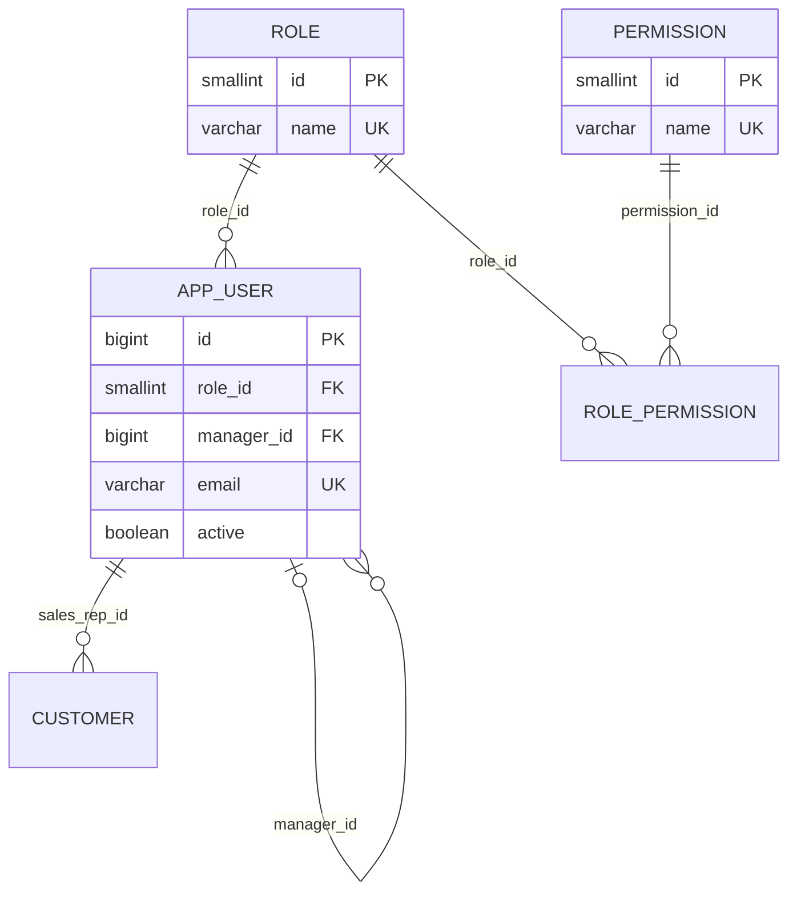
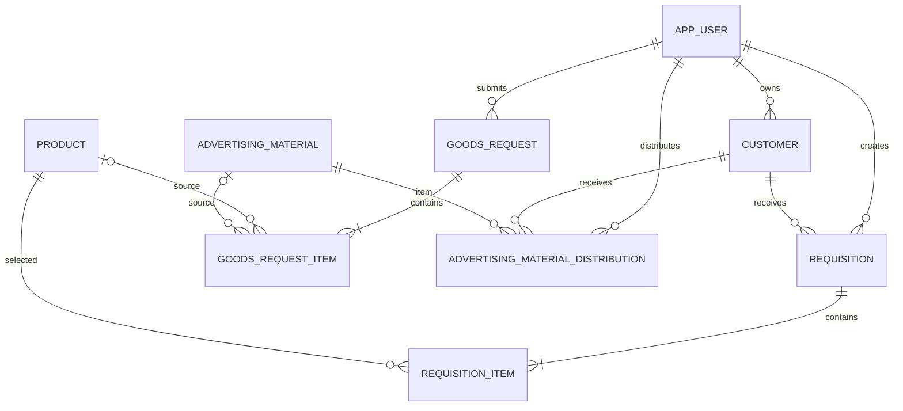
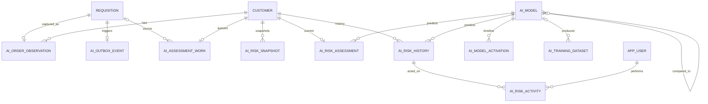
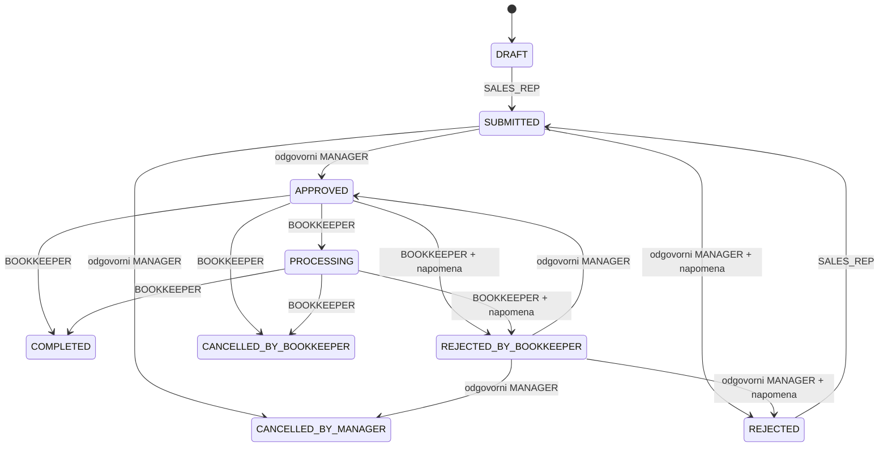
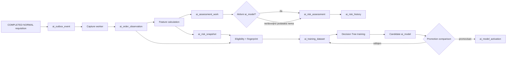
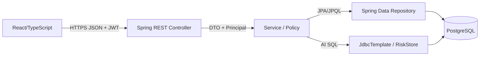

# Arhitektura PostgreSQL baze podataka

## Status dokumenta i izvori istine

Ovaj dokument opisuje završno stanje baze podataka aplikacije **Sena Spirits – Respekt**. Nastao je analizom:

- referentnog snimka `database/schema.sql`;
- metapodataka aktivne PostgreSQL baze, pročitanih isključivo `SELECT` upitima;
- JPA entiteta u `com.ognjen.diplomski.entity`;
- Spring Data repozitorijuma, servisnih transakcija i bezbednosnih pravila;
- JDBC sloja i lifecycle servisa u `com.ognjen.diplomski.ai`.

Provera uživo izvršena je 19. novembra 2026. nad PostgreSQL 18.4. Potvrđeno je postojanje 27 tabela u šemi `public`. Tokom provere nije izvršen nijedan DDL ili DML iskaz. Operativna baza je izvor istine; `schema.sql` je referentni snimak i sam po sebi ne menja bazu.

---

## 1. Pregled baze podataka

### 1.1. Namena

Baza objedinjuje četiri vrste podataka:

1. **identitet i autorizaciju** — korisnici, hijerarhija zaposlenih, uloge i dozvole;
2. **operativno poslovanje** — kupci, proizvodi, trebovanja, zahtevi za robu i reklamni materijal;
3. **izveštavanje** — prodajni i GRATIS pokazatelji izvedeni iz završenih trebovanja i njihovih stavki;
4. **AI Decision Tree podsistem** — opservacije, feature snapshot-i, modeli, procene rizika, istorija, radni redovi, audit i monitoring.

PostgreSQL čuva trajno stanje i sprovodi referencijalni integritet. Spring Boot sprovodi poslovni tok, autorizaciju, validaciju prelaza statusa i transakcione granice. React nikada ne pristupa bazi direktno.

### 1.2. Veza Spring Boot aplikacije

Konekcija se podešava spoljnim vrednostima:

```properties
spring.datasource.url=${DB_URL}
spring.datasource.username=${DB_USERNAME}
spring.datasource.password=${DB_PASSWORD}
spring.jpa.hibernate.ddl-auto=validate
spring.sql.init.mode=never
```

`ddl-auto=validate` znači da Hibernate proverava mapiranja, ali ne kreira niti menja šemu. `spring.sql.init.mode=never` isključuje automatsko izvršavanje SQL skripti. Kredencijali nisu deo izvornog koda, već dolaze iz okruženja ili ignorisanog lokalnog `.env.properties` fajla.

### 1.3. Organizacija pristupa podacima

- Poslovne tabele koriste JPA entitete i `JpaRepository` interfejse.
- Složeniji pregledi koriste JPQL projekcije, agregacije, `Pageable`, `EntityGraph` i namenski definisane `countQuery` upite.
- AI tabele nemaju JPA entitete; `RiskStore` i lifecycle servisi koriste `JdbcTemplate` i eksplicitni SQL.
- Servisi označeni sa `@Transactional` određuju atomsku granicu promene, dok `readOnly = true` označava čitalačke tokove.
- `RequisitionRepository.findForUpdate` koristi `PESSIMISTIC_WRITE` nad roditeljskim redom i timeout `0`, čime sprečava konkurentne odluke nad istim trebovanjem.

---

## 2. Kompletna dokumentacija tabela

### 2.1. Autorizacija i organizaciona struktura

#### `role`

Čuva poslovne uloge, na primer `CEO`, `MANAGER`, `SALES_REP` i `BOOKKEEPER`.

| Kolona | Tip | Obavezna | Značenje |
|---|---|---:|---|
| `id` | `smallint` identity | da | Primarni ključ. |
| `name` | `varchar(30)` | da | Jedinstveni naziv uloge. |

- PK: `id`; UNIQUE: `name`.
- Veze: 1:N ka `app_user`; M:N ka `permission` preko `role_permission`.
- Modul: autentikacija, Spring Security i upravljanje zaposlenima.

#### `permission`

Katalog granularnih dozvola, npr. `customers.read` ili `requisitions.create`.

| Kolona | Tip | Obavezna | Značenje |
|---|---|---:|---|
| `id` | `smallint` identity | da | Primarni ključ. |
| `name` | `varchar(100)` | da | Jedinstveni tehnički naziv dozvole. |

- PK: `id`; UNIQUE: `name`.
- Veza M:N sa `role` preko `role_permission`.
- Modul: JWT principal, autorizacija ruta i servisna kontrola pristupa.

#### `role_permission`

Spojna tabela koja realizuje M:N odnos uloga i dozvola.

| Kolona | Tip | Obavezna | Značenje |
|---|---|---:|---|
| `role_id` | `smallint` | da | FK ka `role.id`. |
| `permission_id` | `smallint` | da | FK ka `permission.id`. |

- Složeni PK: (`role_id`, `permission_id`) sprečava duplikate.
- Oba FK imaju `ON DELETE CASCADE`; brisanje uloge ili dozvole uklanja samo spojne redove.
- Indeks `idx_role_permission_permission` ubrzava obrnutu pretragu po dozvoli.
- JPA: `Role.permissions` je `@ManyToMany(fetch = EAGER)`.

#### `app_user`

Čuva zaposlene i njihove kredencijale. Ista tabela predstavlja direktore, menadžere, komercijaliste i knjigovođe.

| Kolona | Tip | Obavezna | Podrazumevano | Značenje |
|---|---|---:|---|---|
| `id` | `bigint` identity | da | — | PK korisnika. |
| `role_id` | `smallint` | da | — | FK ka `role.id`. |
| `manager_id` | `bigint` | ne | `NULL` | Samoreferentni FK ka nadređenom `app_user.id`. |
| `first_name`, `last_name` | `varchar(50)` | da | — | Ime i prezime. |
| `email` | `varchar(255)` | da | — | Jedinstveni login identifikator. |
| `password_hash` | `text` | da | — | BCrypt hash; lozinka se ne čuva otvoreno. |
| `phone` | `varchar(50)` | ne | `NULL` | Kontakt telefon. |
| `active` | `boolean` | da | `true` | Omogućava deaktivaciju naloga bez brisanja. |
| `created_at` | `timestamptz` | da | `now()` | Vreme nastanka. |

- UNIQUE: `email`; indeksi: `idx_app_user_role`, `idx_app_user_manager`.
- FK su `DEFERRABLE`, ali bez `ON DELETE CASCADE`; povezani poslovni podaci sprečavaju nebezbedno fizičko brisanje.
- Hijerarhija: jedan menadžer ima više prodajnih predstavnika; korisnik ima najviše jednog menadžera.
- Moduli: autentikacija, zaposleni/timovi, kupci, trebovanja, izveštaji, AI aktivnosti.

### 2.2. Kupci i proizvodi

#### `customer`

Predstavlja prodajni objekat ili kupca dodeljenog jednom komercijalisti.

| Kolona | Tip | Obavezna | Podrazumevano | Značenje |
|---|---|---:|---|---|
| `id` | `bigint` identity | da | — | PK kupca. |
| `sales_rep_id` | `bigint` | da | — | FK ka odgovornom `app_user`. |
| `object_name`, `company_name` | `varchar(300)` | da | — | Naziv objekta i pravnog lica. |
| `pib` | `varchar(20)` | da | — | Poreski identifikator. |
| `phone` | `varchar(50)` | ne | `NULL` | Telefon. |
| `email` | `varchar(255)` | ne | `NULL` | Adresa za slanje dokumenta. |
| `address` | `varchar(300)` | da | — | Fizička adresa. |
| `google_maps_url` | `text` | ne | `NULL` | Link ka mapi. |
| `note` | `text` | ne | `NULL` | Poslovna napomena. |
| `status` | `varchar(20)` | da | `DRAFT` | `DRAFT`, `APPROVED`, `DEACTIVATED`, `DELETED`. |
| `created_at`, `updated_at` | `timestamptz` | da | `now()` | Audit vremena. |

- CHECK `chk_customer_status` ograničava status.
- Indeksi: `idx_customer_sales_rep`, kompozitni `idx_customer_sales_rep_status`, `idx_customer_object_name`.
- Nema UNIQUE ograničenja nad `pib`; više objekata istog pravnog lica zato može deliti PIB. To je potrebno potvrditi kao namerno poslovno pravilo pre eventualnog pooštravanja.
- Veze: N:1 ka komercijalisti; 1:N ka trebovanjima, distribucijama i većini AI tabela.
- Modul: kupci, AI katalog, trebovanja, reklamni materijal.

#### `product`

Katalog prodajnih proizvoda i izvor cenovnih, volumenskih i stimulacionih podataka.

| Kolona | Tip | Obavezna | Podrazumevano | Značenje |
|---|---|---:|---|---|
| `id` | `bigint` identity | da | — | PK proizvoda. |
| `code` | `varchar(100)` | da | — | Jedinstvena poslovna šifra. |
| `name` | `varchar(200)` | da | — | Naziv. |
| `price` | `numeric(10,2)` | da | — | Trenutna cena. |
| `picture_url` | `varchar(500)` | da | `products/placeholder.jpg` | Relativna putanja slike. |
| `volume_liters` | `numeric(10,3)` | da | `1.000` | Zapremina jedinice. |
| `package_type` | `varchar(20)` | da | `BOTTLE` | `BOTTLE` ili `JUG`. |
| `stimulation_per_unit` | `numeric(10,2)` | da | `0` | Stimulacija komercijaliste. |
| `manager_stimulation_per_unit` | `numeric(10,2)` | da | `0.00` | Stimulacija menadžera. |
| `active` | `boolean` | da | `true` | Logička dostupnost. |

- UNIQUE: `code`; CHECK: pozitivan volumen, dozvoljen tip pakovanja i nenegativne stimulacije.
- Indeks `idx_product_active` podržava katalog aktivnih proizvoda.
- Veze: 1:N ka `requisition_item` i opciono ka `goods_request_item`.
- Modul: proizvodi, trebovanja, zahtevi za robu, prodajni izveštaji.

### 2.3. Trebovanja

#### `requisition`

Zaglavlje prodajnog ili GRATIS trebovanja. Čuva vlasništvo, kupca, poslovni tip i workflow stanje.

| Kolona | Tip | Obavezna | Podrazumevano | Značenje |
|---|---|---:|---|---|
| `id` | `bigint` identity | da | — | PK trebovanja. |
| `customer_id` | `bigint` | da | — | FK ka `customer.id`. |
| `sales_rep_id` | `bigint` | da | — | FK ka autoru/vlasniku. |
| `type` | `varchar(20)` | da | — | `NORMAL` ili `GRATIS`. |
| `gratis_reason` | `varchar(30)` | ne | `NULL` | `LISTING`, `CONSUMPTION`, `GIFT`, `OTHER`. |
| `custom_reason` | `text` | ne | `NULL` | Tekst samo kada je razlog `OTHER`. |
| `note` | `text` | ne | `NULL` | Opšta napomena. |
| `created_at` | `timestamptz` | da | `now()` | Datum kreiranja i osnova mesečnih izveštaja. |
| `sent_at` | `timestamptz` | ne | `NULL` | Trenutak slanja menadžeru. |
| `status` | `varchar(40)` | da | `DRAFT` | Trenutno workflow stanje. |
| `status_note` | `text` | ne | `NULL` | Razlog odbijanja/otkazivanja. |

- CHECK ograničenja validiraju tip, GRATIS kombinaciju i dozvoljene statuse.
- Indeksi: `idx_requisition_customer`, `idx_requisition_sales_rep`, `idx_requisition_sales_rep_date`.
- FK ka kupcu i korisniku su `DEFERRABLE`, bez kaskadnog brisanja.
- Veze: 1:N ka stavkama; 1:0..1 ka AI opservaciji i outbox događaju; 1:N/0..1 ka assessment work redu.
- Moduli: workflow trebovanja, dashboard, izveštaji, PDF/e-mail i AI capture.

#### `requisition_item`

Stavka proizvoda i količine unutar trebovanja. `stimulation_per_unit` je snapshot stimulacije u trenutku formiranja, pa istorijski izveštaj ne mora zavisiti od kasnije promene proizvoda.

| Kolona | Tip | Obavezna | Značenje |
|---|---|---:|---|
| `id` | `bigint` identity | da | PK stavke. |
| `requisition_id` | `bigint` | da | FK ka zaglavlju. |
| `product_id` | `bigint` | da | FK ka proizvodu. |
| `quantity` | `numeric(10,2)` | da | Količina, mora biti `> 0`. |
| `stimulation_per_unit` | `numeric(10,2)` | da | Istorijski snapshot, mora biti `>= 0`. |

- UNIQUE indeks (`requisition_id`, `product_id`) zabranjuje isti proizvod dva puta u jednom trebovanju.
- `requisition_id` ima `ON DELETE CASCADE`; JPA dodatno koristi `cascade = ALL` i `orphanRemoval = true`.
- Indeksi postoje nad oba FK.

### 2.4. Zahtevi za robu

#### `goods_request`

Zaglavlje internog zahteva komercijaliste za proizvode, reklamni materijal ili slobodno unetu stavku.

| Kolona | Tip | Obavezna | Podrazumevano | Značenje |
|---|---|---:|---|---|
| `id` | `bigint` identity | da | — | PK zahteva. |
| `sales_rep_id` | `bigint` | da | — | FK ka podnosiocu. |
| `note` | `text` | ne | `NULL` | Opšta napomena. |
| `created_at` | `timestamptz` | da | `now()` | Datum zahteva. |

- Indeks `idx_goods_request_sales_rep`.
- Veza 1:N ka `goods_request_item`; JPA kaskada i orphan removal.

#### `goods_request_item`

Pojedinačna tražena stavka. Tačno jedan od tri izvora mora biti popunjen: proizvod, reklamni materijal ili slobodan naziv.

| Kolona | Tip | Obavezna | Podrazumevano | Značenje |
|---|---|---:|---|---|
| `id` | `bigint` identity | da | — | PK. |
| `goods_request_id` | `bigint` | da | — | FK ka zahtevu, `ON DELETE CASCADE`. |
| `product_id` | `bigint` | ne | `NULL` | Opcioni FK ka proizvodu. |
| `material_id` | `bigint` | ne | `NULL` | Opcioni FK ka reklamnom materijalu. |
| `custom_item_name` | `varchar(200)` | ne | `NULL` | Slobodno uneta stavka. |
| `quantity` | `numeric(10,2)` | da | — | Pozitivna količina. |
| `note` | `text` | ne | `NULL` | Napomena. |
| `status` | `varchar(20)` | da | `PENDING` | `PENDING`, `APPROVED`, `REJECTED`. |

- CHECK zahteva tačno jedan izvor; isto pravilo se proverava i metodom `@PrePersist/@PreUpdate`.
- CHECK validira status i pozitivnu količinu.
- Indeks `idx_goods_request_item_request` ubrzava učitavanje stavki roditelja.

### 2.5. Reklamni materijal

#### `advertising_material`

Katalog reklamnog materijala.

| Kolona | Tip | Obavezna | Podrazumevano | Značenje |
|---|---|---:|---|---|
| `id` | `bigint` identity | da | — | PK. |
| `name` | `varchar(150)` | da | — | Jedinstveni naziv. |
| `active` | `boolean` | da | `true` | Logička dostupnost. |

- UNIQUE: `name`.
- Veze: 1:N ka distribucijama i opcionim stavkama zahteva za robu.

#### `advertising_material_distribution`

Evidentira količinu materijala koju je komercijalista predao kupcu.

| Kolona | Tip | Obavezna | Podrazumevano | Značenje |
|---|---|---:|---|---|
| `id` | `bigint` identity | da | — | PK. |
| `customer_id` | `bigint` | da | — | FK ka kupcu. |
| `sales_rep_id` | `bigint` | da | — | FK ka komercijalisti. |
| `material_id` | `bigint` | da | — | FK ka materijalu. |
| `quantity` | `numeric(10,2)` | da | — | Pozitivna količina. |
| `note` | `text` | ne | `NULL` | Napomena. |
| `distributed_at` | `timestamptz` | da | `now()` | Datum distribucije. |

- CHECK `quantity > 0`.
- Indeksi nad `customer_id` i `sales_rep_id`; FK ka `material_id` nema poseban neunikatni indeks.
- Sva tri odnosa su JPA `ManyToOne(LAZY)`.

### 2.6. AI šema i infrastruktura

#### `ai_schema_migration`

Evidencija ručno primenjenih AI verzija šeme.

| Kolona | Tip | Obavezna | Podrazumevano |
|---|---|---:|---|
| `version` | `integer` | da | PK |
| `applied_at` | `timestamptz` | da | `now()` |

`RiskStore` dodatno proverava postojanje AI šeme. Ova tabela nije zamena za kompletan migration alat, već lokalni marker AI verzija.

#### `ai_capture_run`

Idempotentna evidencija capture intervala.

| Kolona | Tip | Obavezna | Značenje |
|---|---|---:|---|
| `at` | `timestamptz` | da | PK vremenske tačke capture izvršenja. |

Jedinstveni PK sprečava duplo evidentiranje istog intervala.

#### `ai_model`

Trajno skladište istreniranih Decision Tree modela i njihovih metapodataka.

| Kolona | Tip | Obavezna | Podrazumevano / značenje |
|---|---|---:|---|
| `version` | `uuid` | da | Tehnički PK modela. |
| `model_version` | `text` | da | Čitljiva verzija `V001`, `V002`, ... |
| `trained_at` | `timestamptz` | da | Vreme treninga. |
| `schema_version` | `integer` | da | CHECK trenutno zahteva `1`. |
| `artifact` | `bytea` | da | Serijalizovani Decision Tree artefakt. |
| `sha256` | `text` | da | Kontrolni hash artefakta. |
| `metrics` | `text` | da | Serijalizovane metrike evaluacije. |
| `model_configuration` | `text` | ne | Serijalizovana konfiguracija treninga. |
| `eligible` | `boolean` | da | Da li je kandidat zadovoljio kriterijume. |
| `active` | `boolean` | da | `false`; samo jedan red sme biti aktivan. |
| `provenance` | `text` | da | `PRODUCTION`, `SYNTHETIC_DEMO`, `UNVERIFIED`. |
| `dataset_fingerprint` | `text` | ne | Identitet skupa podataka. |
| `promotion_decision`, `promotion_reason` | `text` | ne | Ishod poređenja kandidata. |
| `promoted_at` | `timestamptz` | ne | Vreme promocije. |
| `compared_to_model` | `uuid` | ne | Samoreferentni FK ka upoređenom modelu. |

- Parcijalni UNIQUE `ai_one_active_model` garantuje najviše jedan aktivan model.
- Parcijalni UNIQUE `ai_model_dataset_once` sprečava trening istog fingerprint-a više puta.
- UNIQUE i format CHECK štite `model_version`.
- `AiModelService` pri aktivaciji dodatno zaključava tabelu, deaktivira prethodni model i zapisuje istoriju aktivacije u jednoj transakciji.

#### `ai_model_activation`

Neizmenjiva vremenska linija aktiviranja i zamene modela.

| Kolona | Tip | Obavezna | Podrazumevano / značenje |
|---|---|---:|---|
| `id` | `bigserial` | da | PK. |
| `model_id` | `uuid` | da | FK ka aktiviranom modelu. |
| `model_version` | `text` | da | Snapshot čitljive verzije. |
| `activated_at` | `timestamptz` | da | `now()`. |
| `deactivated_at` | `timestamptz` | ne | Kraj važenja; ne sme biti pre aktivacije. |
| `replaced_model_id`, `replaced_by_model_id` | `uuid` | ne | FK ka prethodnom/sledećem modelu. |
| `reason` | `text` | da | Razlog aktivacije. |

- Parcijalni UNIQUE po `model_id` gde je `deactivated_at IS NULL` sprečava više otvorenih perioda istog modela.
- Indeks vremenske linije: (`activated_at DESC`, `id DESC`).

#### `ai_order_observation`

Normalizovana prodajna opservacija nastala iz završenog `NORMAL` trebovanja.

| Kolona | Tip | Obavezna | Značenje |
|---|---|---:|---|
| `requisition_id` | `bigint` | da | PK i FK ka `requisition`; garantuje idempotentnost capture-a. |
| `customer_id` | `bigint` | da | FK ka kupcu. |
| `created_at` | `timestamptz` | da | Poslovno vreme trebovanja. |
| `observed_at` | `timestamptz` | da | Vreme capture-a. |
| `liters` | `double precision` | da | Izračunata litraža. |

- Indeks (`customer_id`, `created_at`) podržava vremenske feature-e.
- Baza trenutno nema CHECK `liters >= 0`; validnost zavisi od izvora i servisnog izračunavanja.

#### `ai_risk_snapshot`

Istorijski snimak feature vektora kupca korišćen za sazrevanje trening primera.

| Kolona | Tip | Obavezna | Značenje |
|---|---|---:|---|
| `id` | `bigserial` | da | PK. |
| `customer_id` | `bigint` | da | FK ka kupcu. |
| `at` | `timestamptz` | da | Vreme feature snimka. |
| `features` | `text` | da | Serijalizovani feature-i. |

- UNIQUE (`customer_id`, `at`) i indeks istih kolona sprečavaju duplikate i ubrzavaju istoriju.

#### `ai_risk_assessment`

Materijalizuje samo poslednju poznatu procenu svakog kupca.

| Kolona | Tip | Obavezna | Značenje |
|---|---|---:|---|
| `customer_id` | `bigint` | da | PK i FK ka kupcu — najviše jedna aktuelna procena. |
| `at` | `timestamptz` | da | Vreme procene. |
| `level` | `text` | da | `LOW`, `MEDIUM`, `HIGH`, `INSUFFICIENT_DATA`. |
| `status` | `text` | da | Operativni status procene. |
| `model_version` | `uuid` | ne | FK ka modelu; može biti `NULL` za nedovoljno podataka. |
| `features`, `explanation` | `text` | da | Serijalizovani ulazi i objašnjenje. |
| `previous_level` | `text` | ne | Prethodni nivo unutar iste verzije modela. |

- Indeks (`level`, `customer_id`) podržava AI katalog i distribuciju rizika.
- CHECK postoji za `level`, ali ne i za `status` i `previous_level`; te vrednosti kontroliše aplikacija.

#### `ai_risk_history`

Append-only istorija procena po kupcu i vremenu.

| Kolona | Tip | Obavezna | Značenje |
|---|---|---:|---|
| `customer_id` | `bigint` | da | FK ka kupcu. |
| `at` | `timestamptz` | da | Vreme procene. |
| `level` | `text` | da | Istorijski nivo rizika. |
| `model_version` | `uuid` | ne | FK ka modelu. |

- Složeni PK (`customer_id`, `at`).
- Za razliku od aktuelne procene, `level` ovde nema DB CHECK; konzistentnost zavisi od servisnog upisa.
- Na ovaj složeni ključ se poziva `ai_risk_activity`.

#### `ai_risk_activity`

Audit poslovnih aktivnosti nad konkretnom istorijskom procenom.

| Kolona | Tip | Obavezna | Značenje |
|---|---|---:|---|
| `id` | `bigserial` | da | PK. |
| `customer_id` | `bigint` | da | FK ka kupcu. |
| `actor_id` | `bigint` | da | FK ka korisniku koji je uneo aktivnost. |
| `assessment_at` | `timestamptz` | da | Sa `customer_id` čini FK ka `ai_risk_history`. |
| `type` | `text` | da | `CONTACT`, `INVESTIGATE`, `MONITOR`. |
| `at` | `timestamptz` | da | `now()`, vreme aktivnosti. |
| `notes` | `varchar(2000)` | ne | Napomena. |
| `outcome` | `varchar(1000)` | da | Ishod kontakta/akcije. |

- Indeks (`customer_id`, `at DESC`) podržava audit kupca.
- Složeni FK garantuje da aktivnost referencira stvarno istorijsko merenje tog kupca.

#### `ai_outbox_event`

Trajni transactional-outbox red za capture završenih trebovanja.

| Kolona | Tip | Obavezna | Podrazumevano / značenje |
|---|---|---:|---|
| `id` | `bigserial` | da | PK. |
| `event_type` | `text` | da | Samo `REQUISITION_COMPLETED`. |
| `requisition_id` | `bigint` | da | UNIQUE FK, `ON DELETE CASCADE`. |
| `status` | `text` | da | `PENDING`; zatim `PROCESSING`, `COMPLETED`, `FAILED`. |
| `attempts` | `integer` | da | `0`, nenegativan broj pokušaja. |
| `available_at`, `locked_until` | `timestamptz` | da/ne | Raspoloživost i lease. |
| `created_at`, `completed_at` | `timestamptz` | da/ne | Audit vremena. |
| `last_error` | `text` | ne | Poslednja greška. |

- UNIQUE `requisition_id` daje idempotentnost.
- Indeks (`status`, `available_at`, `id`) ubrzava preuzimanje radova.
- Događaj se upisuje samo za prelazak `NORMAL` trebovanja u `COMPLETED`, uz očuvano commit uređenje.

#### `ai_assessment_work`

Trajni red za procenu ili ponovnu procenu kupca, sa retry i lease semantikom.

| Kolona | Tip | Obavezna | Podrazumevano / značenje |
|---|---|---:|---|
| `customer_id` | `bigint` | da | PK, FK `ON DELETE CASCADE`; jedan konsolidovan rad po kupcu. |
| `requisition_id` | `bigint` | ne | FK `ON DELETE SET NULL` ka događaju koji je pokrenuo rad. |
| `source` | `text` | da | Izvor zahteva. |
| `snapshot` | `boolean` | da | `false`; da li treba čuvati snapshot. |
| `generation` | `bigint` | da | `1`; otkriva noviji zahtev tokom obrade. |
| `status` | `text` | da | `PENDING`, `PROCESSING`, `COMPLETED`, `FAILED`. |
| `attempts` | `integer` | da | `0`, CHECK nenegativno. |
| `available_at`, `locked_until` | `timestamptz` | da/ne | Retry/lease kontrola. |
| `created_at`, `updated_at`, `completed_at` | `timestamptz` | da/da/ne | Audit vremena. |
| `last_error` | `text` | ne | Poslednja greška. |

- Indeks (`status`, `available_at`, `customer_id`) podržava worker claim.
- UPSERT povećava `generation`, spaja snapshot zahtev i ne gubi događaj koji stigne tokom aktivne obrade.

#### `ai_lifecycle_lock`

Distribuirani lease za operacije koje smeju imati samo jednog vlasnika, prvenstveno trening.

| Kolona | Tip | Obavezna | Podrazumevano / značenje |
|---|---|---:|---|
| `lock_name` | `text` | da | PK, npr. `TRAINING`. |
| `owner_id` | `uuid` | ne | Identitet instance/vlasnika. |
| `lease_until` | `timestamptz` | ne | Rok važenja. |
| `updated_at` | `timestamptz` | da | `now()`. |

Atomic `UPDATE ... WHERE lease_until < now()` sprečava paralelni trening više instanci.

#### `ai_job_execution`

Operativni audit svakog lifecycle posla.

| Kolona | Tip | Obavezna | Podrazumevano / značenje |
|---|---|---:|---|
| `id` | `uuid` | da | PK izvršenja. |
| `job_type` | `text` | da | `CAPTURE`, `SNAPSHOT`, `ASSESSMENT`, `ELIGIBILITY`, `TRAINING`. |
| `status` | `text` | da | `RUNNING`, `COMPLETED`, `SKIPPED`, `FAILED`, `ABANDONED`, `MISSED`. |
| `dataset_fingerprint` | `text` | ne | Veza po vrednosti ka dataset-u; nije FK. |
| `owner_id` | `uuid` | ne | Instanca koja izvršava posao. |
| `started_at`, `completed_at` | `timestamptz` | da/ne | Trajanje. |
| `outcome`, `details`, `error_message` | `text` | ne | Rezultat i dijagnostika. |
| `schedule_key` | `text` | ne | Jedinstveni termin rasporeda. |

- Indeks (`job_type`, `started_at DESC`).
- Parcijalni UNIQUE (`job_type`, `schedule_key`) sprečava dupliranje istog zakazanog termina.

#### `ai_training_dataset`

Idempotentni zapis pripreme, evaluacije i ishoda trening skupa.

| Kolona | Tip | Obavezna | Podrazumevano / značenje |
|---|---|---:|---|
| `fingerprint` | `text` | da | PK sadržaja dataseta. |
| `status` | `text` | da | `RUNNING`, `EVALUATED`, `PROMOTED`, `REJECTED`, `FAILED_RETRYABLE`, `FAILED`. |
| `mature_count`, `training_count`, `evaluation_count` | `integer` | da | Brojevi uzoraka. |
| `class_distribution` | `text` | da | Serijalizovana raspodela klasa. |
| `first_snapshot_at`, `last_snapshot_at` | `timestamptz` | ne | Granice izvora. |
| `created_at`, `completed_at`, `retry_after` | `timestamptz` | da/ne/ne | Lifecycle vremena. |
| `attempts` | `integer` | da | `1`; broj pokušaja. |
| `model_version` | `uuid` | ne | FK ka modelu, `ON DELETE SET NULL`. |
| `decision_reason` | `text` | ne | Objašnjenje ishoda. |

Fingerprint sprečava nepotrebno treniranje nepromenjenog skupa podataka.

#### `ai_system_state`

Singleton materijalizovani monitoring status AI podsistema.

| Grupa kolona | Tip | Značenje |
|---|---|---|
| `singleton` | `boolean` PK | CHECK zahteva `true`, pa može postojati samo jedan red. |
| `operational_status` | `text` | Trenutno zdravstveno stanje, podrazumevano `STARTING`. |
| `last_capture_at`, `last_snapshot_at`, `last_assessment_refresh_at` | `timestamptz` | Poslednja uspešna obrada. |
| `last_eligibility_check_at`, `last_training_attempt_at` | `timestamptz` | Trening lifecycle. |
| `last_training_outcome`, `last_promotion_decision`, `last_promotion_reason` | `text` | Poslednji ishodi. |
| `eligible_sample_count`, `new_mature_sample_count` | `integer` | Brojači, podrazumevano `0`. |
| `scheduler_heartbeat_at` | `timestamptz` | Dokaz rada schedulera. |
| `persistent_error`, `assessment_error`, `capture_error`, `snapshot_error`, `training_error`, `other_error` | `text` | Kategorizovane greške. |
| `updated_at` | `timestamptz` | Poslednja promena, `now()`. |

Ova tabela omogućava jeftin monitoring bez agregiranja celog audit dnevnika pri svakom API pozivu.

---

## 3. Odnosi entiteta

### 3.1. Autorizacija i zaposleni



M:N odnos postoji samo između `role` i `permission`. Organizaciona hijerarhija je samoreferentni N:1 odnos u `app_user`. Baza ne proverava da `manager_id` nužno pokazuje na korisnika sa ulogom `MANAGER`; to je aplikaciono pravilo.

### 3.2. Prodaja i operativni moduli



Brisanje roditeljskog `requisition` ili `goods_request` kaskadno briše stavke. Ostali poslovni FK uglavnom koriste podrazumevani `NO ACTION`, jer aplikacija koristi deaktivaciju i status `DELETED` umesto fizičkog brisanja istorijski značajnih podataka.

### 3.3. AI odnosi



AI FK uglavnom koriste `NO ACTION` kako audit ne bi nestao neprimetno. Izuzeci su radni redovi i outbox: oni eksplicitno koriste `CASCADE` ili `SET NULL` kada je to deo lifecycle semantike.

---

## 4. Moduli baze

### 4.1. Korisnici, uloge, dozvole i timovi

`app_user`, `role`, `permission` i `role_permission` čine autentikacionu osnovu. JWT nosi identitet, ali se aktivnost korisnika i njegove dozvole i dalje proveravaju prema bazi. `manager_id` formira timove. Servisni sloj dodatno proverava da CEO upravlja zaposlenima i da menadžer vidi samo svoj tim.

### 4.2. Kupci

Kupac pripada jednom komercijalisti. Status kontroliše workflow od nacrta do odobrenja/deaktivacije. `CustomerRepository.search` primenjuje status, tekstualnu pretragu i autorizacioni scope pre paginacije i count upita. CEO ima širi scope, menadžer scope tima, a komercijalista sopstvene kupce.

### 4.3. Proizvodi

Katalog je centralni izvor šifre, cene, zapremine, tipa pakovanja i stimulacija. Deaktivacija čuva istorijske FK. Management pregled koristi DB paginaciju; mali aktivni katalog za unos trebovanja učitava se kao referentna lista.

### 4.4. Trebovanja

`requisition` i `requisition_item` predstavljaju prodajni dokument. Servis zaključava roditeljski red pri izmeni statusa, proverava revision fingerprint, sinhronizuje stavke i čuva stimulacioni snapshot. Završena trebovanja hrane izveštaje, a završena `NORMAL` trebovanja pokreću AI outbox.

### 4.5. Zahtevi za robu

Zahtev sadrži heterogene stavke, ali DB CHECK garantuje tačno jedan izvor po stavci. Status se vodi po stavci, što omogućava parcijalno odobravanje. Mesečni istorijski upiti trenutno vraćaju liste, ne DB stranice.

### 4.6. Reklamni materijal

Katalog materijala odvojen je od evidencije distribucije. Distribucija je događaj vezan za kupca, komercijalistu i materijal, što omogućava istoriju bez menjanja kupca ili kataloga.

### 4.7. Izveštaji i prodaja

Ne postoji posebna tabela izveštaja. `SalesReportRepository` agregira završena trebovanja i stavke direktno u projekcije:

- broj boca i balona;
- litre (`quantity * volume_liters`);
- stimulacije komercijaliste i menadžera;
- GRATIS količine i razloge;
- mesečne, timske i menadžerske komparacije.

Izveštaji filtriraju `COMPLETED` i odgovarajući period/scope pre agregacije. RF-04 kalkulatori ostaju referentna logika, dok SQL projekcije izbegavaju učitavanje kompletnih grafova entiteta.

### 4.8. AI Decision Tree

AI modul koristi sopstveni SQL persistence sloj jer radi sa binarnim artefaktima, lease redovima, upsert-ima, audit istorijom i batch obradom. `ai_model.artifact` čuva serijalizovano stablo, dok `sha256` omogućava proveru integriteta. Model nije Python servis; učitava se i izvršava u Java backendu.

---

## 5. Workflow trebovanja

### 5.1. Statusi

DB CHECK dozvoljava:

```text
DRAFT
SUBMITTED
APPROVED
REJECTED
REJECTED_BY_BOOKKEEPER
PROCESSING
COMPLETED
CANCELLED_BY_MANAGER
CANCELLED_BY_BOOKKEEPER
```

### 5.2. Ko sprovodi pravila

| Pravilo | PostgreSQL | Java |
|---|---:|---:|
| Status mora biti iz poznatog skupa | da | enum |
| `NORMAL` nema GRATIS razlog | da | da |
| `GRATIS` ima razlog, a `OTHER` tekst | da | da |
| Količina stavke je pozitivna | da | da |
| Proizvod se ne ponavlja u trebovanju | da | detekcija pre upisa |
| Dozvoljeni prelaz statusa po ulozi | ne | `RequisitionWorkflowPolicy` |
| Menadžer pripada timu autora | ne | `RequisitionWorkflowPolicy` |
| Napomena je obavezna pri odbijanju | ne | servis/policy |
| Konkurentna izmena/revision konflikt | zaključavanje + transakcija | servis |

Tipičan tok je:



`status_note` čuva napomenu uz odbijanje ili otkazivanje. `sent_at` se postavlja pri `SUBMITTED`. Stavke referenciraju proizvod, ali stimulacija komercijaliste se snapshot-uje u `requisition_item`; deo aktuelnih SQL izveštaja koristi i trenutne atribute proizvoda, što je važno pri tumačenju istorijskih rezultata.

Završeno `NORMAL` trebovanje atomarno dovodi do durable outbox događaja. Capture ga pretvara u `ai_order_observation`; `GRATIS` se ne koristi kao normalna prodajna opservacija.

---

## 6. AI arhitektura baze

### 6.1. Tok podataka



### 6.2. Procena rizika

`AiAssessmentService` batch učitava kupce, opservacije, prethodne procene i aktivni model. Aktuelna procena se upisuje UPSERT-om u `ai_risk_assessment`, dok se istorijski red dodaje u `ai_risk_history`. Snapshot se čuva samo kada workflow to zahteva. Procena bez dovoljno podataka koristi `INSUFFICIENT_DATA` i može imati `NULL model_version`.

### 6.3. Trening i verzionisanje

Eligibility računa zrele uzorke iz snapshot-a i budućeg ponašanja/opservacija. Fingerprint identifikuje sadržaj dataseta. Trening deli podatke na training/evaluation skup, serijalizuje stablo u `artifact`, čuva metrike i poredi kandidata sa aktivnim modelom. Jedinstveni fingerprint sprečava ponavljanje nepromenjenog treninga.

`ai_one_active_model` je poslednja DB odbrana od dva aktivna modela. Aplikacija dodatno koristi ekskluzivno zaključavanje `ai_model` tokom promocije i `ai_lifecycle_lock` za koordinaciju treninga između instanci.

### 6.4. Pouzdanost, retry i monitoring

- `ai_outbox_event` sprečava gubitak capture događaja.
- `ai_assessment_work` sprečava gubitak procene i podržava retry.
- `locked_until` omogućava oporavak posle pada procesa.
- `ai_job_execution` daje istoriju uspeha, preskakanja, grešaka i propuštenih termina.
- `ai_system_state` daje jeftin trenutni health prikaz.
- `ai_audit` aplikacioni logovi dopunjuju, ali ne zamenjuju, DB audit tabele.

---

## 7. Integritet i bezbednost podataka

### 7.1. Referencijalni integritet

PostgreSQL FK sprečavaju orphan redove. Kaskadno brisanje je ograničeno na prirodno vlasničke odnose (`requisition_item`, `goods_request_item`, outbox i assessment work). Istorijske relacije uglavnom koriste `NO ACTION` da brisanje kupca, korisnika, proizvoda ili modela ne ukloni audit neprimetno.

### 7.2. CHECK i UNIQUE odbrane

Najvažnije DB odbrane su:

- jedinstveni email, šifra proizvoda, naziv uloge/dozvole/materijala;
- jedan proizvod po trebovanju;
- jedan outbox događaj i jedna opservacija po trebovanju;
- jedna aktuelna procena po kupcu;
- najviše jedan aktivan AI model;
- dozvoljeni enum-like statusi i pozitivne količine;
- validna kombinacija GRATIS polja i izvora stavke zahteva za robu.

### 7.3. Transakcije

Servisni `@Transactional` obuhvata čitanje za proveru, promenu entiteta, sinhronizaciju stavki i flush. Rollback vraća celu operaciju. AI lifecycle koristi transakcije oko claim/process/finalize koraka i idempotentne UNIQUE/UPSERT obrasce. Outbox izbegava nepouzdani fire-and-forget poziv.

### 7.4. Autorizacija

Spring Security proverava JWT, ulogu i dozvole na HTTP sloju. Servisi zatim primenjuju vlasništvo:

- SALES_REP — sopstveni kupci i trebovanja;
- MANAGER — prodajni predstavnici sopstvenog tima;
- CEO — organizacioni pregled;
- BOOKKEEPER — dozvoljeni statusni scope trebovanja i operativne odluke.

PostgreSQL nema per-user Row Level Security pravila u analiziranoj šemi. Zato je pravilno filtriranje u servisima/repozitorijumima bezbednosno kritično; samo menjanje `page`, `customerId` ili filter parametra ne sme proširiti scope.

---

## 8. Arhitektura pristupa bazi



### 8.1. Kontroler i DTO

Kontroler deserializuje zahtev, pokreće Bean Validation i prosleđuje `AppUserPrincipal`. DTO sprečava direktno izlaganje JPA grafova i cikličnih relacija.

### 8.2. Servis i policy

Servis koordinira use-case i transakciju. Policy klase, kao `CustomerAccessPolicy`, `RequisitionWorkflowPolicy` i report scope resolveri, određuju dozvoljeni obim bez oslanjanja samo na frontend.

### 8.3. Repozitorijum

- Derived queries služe jednostavnim lookup operacijama.
- `EntityGraph` sprečava N+1 pri autentikaciji i batch hidrataciji kupaca.
- JPQL projekcije vraćaju samo polja potrebna listama i agregatima.
- Requisition i product management koriste DB paginaciju.
- Filteri i scope se primenjuju pre `LIMIT/OFFSET`; `countQuery` koristi iste uslove.
- Determinističko sortiranje trebovanja je `createdAt DESC, id DESC`.

### 8.4. Izveštaji

SQL/JPQL agregacije se izvršavaju u PostgreSQL-u, a servis mapira projekcije u postojeće DTO ugovore. Time se izbegava učitavanje svih trebovanja i stavki u JVM. Periodi koriste poluotvoreni interval `[start, end)`, što izbegava probleme sa poslednjim delićem sekunde i čuva ponašanje vremenske zone.

---

## 9. Održavanje baze

### 9.1. Izvor istine

Aktivna PostgreSQL baza je operativni izvor istine. `database/schema.sql` je schema-only snapshot za dokumentovanje i kreiranje nove prazne baze. Menjanje snapshot-a ne menja aktivnu bazu.

### 9.2. Zašto nema automatskih migracija

Projekat nema aktivan Flyway/Liquibase runtime i eksplicitno koristi `spring.sql.init.mode=never`. Time se izbegava nenamerna promena autoritativne lokalne baze pri startu, ali se odgovornost prebacuje na strogo kontrolisan ručni postupak.

### 9.3. Bezbedna rezervna kopija

Primer schema + data backup-a koji ne menja bazu:

```bash
pg_dump --format=custom --host <host> --username <user> --dbname <database> --file <verified-backup.dump>
pg_restore --list <verified-backup.dump>
```

Backup treba čuvati van repozitorijuma i testirati restore u zasebnu praznu bazu. `.gitignore` već isključuje `database/*.backup` i `database/*.dump`, ali to nije zamena za bezbedno skladištenje.

### 9.4. Buduća ručna promena

Za svaku promenu treba:

1. dokumentovati razlog, precondition i rollback;
2. napraviti i proveriti backup;
3. pripremiti numerisanu SQL skriptu sa `ON_ERROR_STOP` i transakcijom gde je moguće;
4. prvo izvršiti na kopiji;
5. primeniti u periodu održavanja;
6. proveriti constraints, indekse i aplikacione testove;
7. ponovo generisati schema-only snapshot.

Snapshot se osvežava tek posle potvrđene promene:

```bash
pg_dump --schema-only --no-owner --no-privileges \
  --host <host> --username <user> --dbname <database> \
  --file database/schema.sql
```

### 9.5. Read-only provera integriteta

Bez menjanja podataka mogu se proveriti:

```sql
SELECT conrelid::regclass, conname, pg_get_constraintdef(oid)
FROM pg_constraint
WHERE connamespace = 'public'::regnamespace
ORDER BY conrelid::regclass::text, conname;

SELECT schemaname, tablename, indexname, indexdef
FROM pg_indexes
WHERE schemaname = 'public'
ORDER BY tablename, indexname;
```

Za performanse koristiti `EXPLAIN (ANALYZE, BUFFERS)` samo u bezbednom lokalnom/test okruženju i samo nad `SELECT` upitima.

---

## 10. Rizici i preporuke

### 10.1. Potvrđeni rizici

| Prioritet | Nalaz | Zašto je važan | Preporuka |
|---|---|---|---|
| visok | Migracije su ručne i nema centralnog automatskog migration mehanizma. | Istorijski je već postojao drift CHECK statusa; neprimenjena skripta može ostaviti Java kod i DB neusaglašene. | Voditi jedinstven registar primenjenih verzija za celu šemu ili planski uvesti kontrolisan migration alat tek posle verifikovanog backup-a. |
| srednji | `ai_risk_history.level`, `ai_risk_assessment.status` i `previous_level` nemaju isti nivo CHECK zaštite kao `ai_risk_assessment.level`. | Ručni ili defektan upis može uneti vrednost koju Java ne očekuje. | Dokumentovati dozvoljene vrednosti i, nakon audita postojećih redova, razmotriti CHECK migraciju. |
| srednji | `metrics`, `features`, `explanation`, `class_distribution` i konfiguracija čuvaju se kao `text`. | Baza ne proverava JSON strukturu i ne može efikasno indeksirati sadržaj. | Zadržati ako su podaci opaque artefakti; pre prelaska na `jsonb` dokazati potrebu i kompatibilnost codec-a. |
| srednji | Goods request i advertising distribution mesečni pregledi vraćaju nepaginirane liste. | Rast istorije povećava memoriju, vreme SQL-a i veličinu odgovora. | Meriti realne volumene; uvesti DB paginaciju kada podaci pređu praktičan prag. |

### 10.2. Potencijalni rizici koji zahtevaju merenje

| Prioritet | Nalaz | Status dokaza | Preporuka |
|---|---|---|---|
| srednji | CEO mesečni requisition i report upiti filtriraju po `created_at`, ali ne postoji samostalan indeks `requisition(created_at)` niti potvrđen optimalni kompozit za sve scope-ove. | Struktura je potvrđena; sporost nije merena. | Koristiti `EXPLAIN (ANALYZE, BUFFERS)` sa reprezentativnim podacima pre dodavanja indeksa. |
| srednji | Pretrage koriste `LOWER(column) LIKE '%term%'`; obični B-tree indeks nad `object_name` uglavnom ne pomaže za vodeći `%`. | Oblik upita je potvrđen; uticaj zavisi od broja kupaca/proizvoda. | Meriti; po potrebi razmotriti `pg_trgm` i GIN, bez menjanja API-ja. |
| srednji | Team summary upiti spajaju komercijaliste, kupce i trebovanja pre `COUNT(DISTINCT ...)`. | Fan-out je potvrđen konstrukcijom; korektnost brojeva je zaštićena `DISTINCT`, ali cena nije izmerena. | Optimizovati preagregiranim podupitima tek ako plan pokaže problem. |
| nizak | `role.permissions` je EAGER. | Potvrđeno mapiranje; katalog dozvola je trenutno mali. | Ostaviti dok profilisanje ne pokaže problem. |

### 10.3. Integritet koji treba svesno zadržati

- Ne uklanjati FK ili CHECK samo radi lakšeg brisanja.
- Ne pretvarati soft-delete domene u fizičko brisanje bez politike retencije.
- Ne uklanjati snapshot stimulaciju iz `requisition_item`.
- Ne zamenjivati outbox asinhronim fire-and-forget pozivom.
- Ne paginirati male referentne kataloge automatski; paginacija ima smisla za rastuću istoriju.

---

## Zaključak

Arhitektura koristi PostgreSQL ne samo kao skladište, već kao sloj integriteta i koordinacije. JPA model pokriva standardne poslovne agregate, dok AI modul koristi eksplicitni SQL za idempotentnost, lease zaključavanje, batch rad i model lifecycle. Najvažnija operativna obaveza je održavanje saglasnosti između Java enum-a i pravila, aktivne PostgreSQL šeme, ručnih migracija i `database/schema.sql` snapshot-a.
